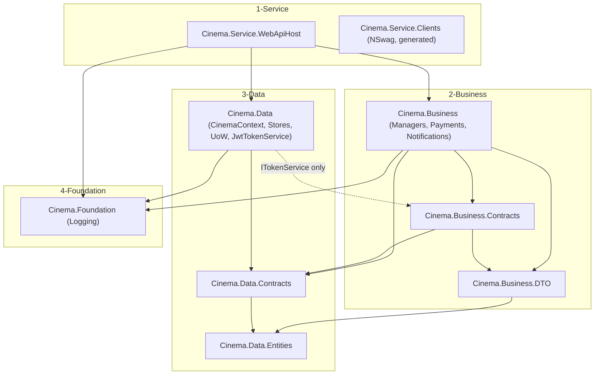

# Backend Architecture

> Purpose: How `cinemabe` is layered, how a request flows end to end, and how auth/realtime/error-handling are wired.
> Sources: `cinemabe/Cinema/**/*.csproj`, `1-Service/Cinema.Service.WebApiHost/Program.cs`, `2-Business/Cinema.Business/DependencyInjection.cs`, `2-Business/Cinema.Business/Managers/BookingManager.cs`, `3-Data/Cinema.Data/DependencyInjection.cs`, `3-Data/Cinema.Data/ApplicationUnitOfWork.cs`, `3-Data/Cinema.Data/Contexts/CinemaContext.cs`, `3-Data/Cinema.Data/Services/JwtTokenService.cs`, `1-Service/Cinema.Service.WebApiHost/{Controllers,Hubs,Middlewares,Services}/*`, `E:\cinema\CLAUDE.md`
> Last reviewed: 2026-11-04

## 1. The 4 numbered layers

Dependency direction is enforced by folder prefix and by actual `ProjectReference`s (verified against every `.csproj` in `cinemabe/Cinema`): a project may only reference a project in the same or a lower-numbered layer, and typically only one tier deeper.

| # | Folder | Project | Role |
|---|---|---|---|
| 1 | `1-Service/` | `Cinema.Service.WebApiHost` | ASP.NET Core 9 Web API host. Controllers, SignalR hubs, middleware, background services, `Program.cs` composition root. |
| 1 | `1-Service/` | `Cinema.Service.Clients` | NSwag-generated HTTP clients (C# + Angular). Not referenced by the host itself; consumed by other .NET clients and copied into `cinemafe`. Do not hand-edit. |
| 1 | `1-Service/` | `Cinema.Service.WebApiHost.Tests` | xUnit tests against the host (e.g. `ControllerArchitectureTests.OnlyThreeControllersExist`). |
| 2 | `2-Business/` | `Cinema.Business.Contracts` | One `I*Manager`/`ITokenService`/gateway interface per file. References `Cinema.Data.Contracts` + `Cinema.Business.DTO` only. |
| 2 | `2-Business/` | `Cinema.Business.DTO` | DTOs grouped by domain (`Auth/`, `Booking/`, `BoxOffice/`, `Catalog/`, `Gate/`, `Invoices/`, `Loyalty/`, `Movies/`, `Operations/`, `Requests/`, `Staff/`, `Theaters/`, `Validation/`). References `Cinema.Data.Entities` only. |
| 2 | `2-Business/` | `Cinema.Business` | Manager implementations, payment gateways, notification services, external-ratings provider. Wired via `AddBusiness()`. |
| 2 | `2-Business/` | `Cinema.Business.Tests` | Dual-purpose: `dotnet run` seeds dev accounts, `dotnet test` runs xUnit suites. |
| 3 | `3-Data/` | `Cinema.Data.Entities` | POCO entities + enums. No project references besides EF Core itself. |
| 3 | `3-Data/` | `Cinema.Data.Contracts` | Store interfaces + `IApplicationUnitOfWork`. References `Cinema.Data.Entities`. |
| 3 | `3-Data/` | `Cinema.Data` | `CinemaContext`, Fluent `Configurations/`, `Stores/`, `ApplicationUnitOfWork`, `JwtTokenService`. References `Cinema.Data.Contracts` **and** `Cinema.Business.Contracts` (for `ITokenService`) + `Cinema.Foundation`. |
| 4 | `4-Foundation/` | `Cinema.Foundation` | Serilog-backed `ILog`/`LogProvider` abstraction. No references to any other Cinema project. |

Notable wrinkle (not in CLAUDE.md's prose but real in the `.csproj`s): `Cinema.Data` references `Cinema.Business.Contracts` (to implement `ITokenService`), so layer 3 reaches one interface back into layer 2 — a deliberate, narrow exception rather than a strict one-way 3→2 ban. `Cinema.Service.WebApiHost` itself references `Cinema.Business`, `Cinema.Data`, and `Cinema.Foundation` directly (not just the "one tier deeper" convention) since it is the composition root.

## 2. Layer dependency graph

## 3. Request flow — controller → manager → store → EF Core → DB

1. **Controller** (`CinemaController`, `IdentityController`, or `PaymentController` — see §5) receives a POST, wrapped in the repo-wide try/catch + `LogProvider.Current` pattern (`"{GetType().Name}.{Method} being awakened…"` on entry, `Fatal` + `HandleException` on error).
2. Controller calls an injected `I*Manager` (from `Cinema.Business.Contracts`, resolved to its `Cinema.Business.Managers.*` implementation via `AddBusiness()`).
3. The manager calls `IApplicationUnitOfWork` (DI singleton-per-scope `ApplicationUnitOfWork`, `cinemabe/Cinema/3-Data/Cinema.Data/ApplicationUnitOfWork.cs`), which exposes one typed `I*Store` property per entity (constructed eagerly in its constructor, e.g. `MovieStore = new MovieStore(db)`), plus `BeginTransactionAsync`/`CommitTransactionAsync`/`RollbackTransactionAsync`/`SaveChangesAsync`.
4. Each store (`Cinema.Data/Stores/*`) wraps `GenericStore<T>` over the shared `CinemaContext` (EF Core `DbContext`), issuing LINQ-to-SQL Server queries.
5. `CinemaContext.OnModelCreating` applies every `IEntityTypeConfiguration<T>` in the assembly (`Configurations/*.cs`) via `ApplyConfigurationsFromAssembly`, then globally rewrites every `DateTime`/`DateTime?` property's column type to `datetime` (not EF's default `datetime2`) — confirmed in `CinemaContext.cs` lines 61-71.
6. The manager maps entities to DTOs (`Cinema.Business.DTO`) and returns them to the controller, which returns them as the HTTP response body (always 200/4xx/5xx JSON; list endpoints return `DefaultSearchResults<T>`).

Multi-step writes (e.g. booking creation, expiry) wrap steps 3-5 inside `BeginTransactionAsync`/`CommitTransactionAsync` for atomicity — see `BookingManager.CreateBookingAsync`/`ExpireStalePendingBookingsAsync` for the reference shape.

## 4. SignalR

Two hubs, both mapped in `Program.cs` (`app.MapHub<BookingHub>("/hubs/booking")`, `app.MapHub<StaffHub>("/hubs/staff")`):

| Hub | Route | Authorize | Purpose |
|---|---|---|---|
| `BookingHub` | `/hubs/booking` | `[Authorize]` (any role) | Live seat-lock broadcast during checkout. Methods: `JoinRoom`, `LockSeat`, `UnlockSeat`; auto-releases a connection's locks `OnDisconnectedAsync`. Backed by `IBookingManager.LockSeat/UnlockSeat/IsSeatLocked/ReleaseConnectionLocks` — two static, process-local `ConcurrentDictionary`s inside `BookingManager` (`_lockedSeats` keyed `"{showTimeId}:{roomId}:{seatId}"`, `_bookingGates` keyed `"{showTimeId}:{roomId}"`). Not distributed: a multi-instance deployment relies on the DB-level filtered unique index on `InvoiceTicket(ShowTimeId, RoomId, SeatId) WHERE IsActive = 1`, not this dictionary, to prevent double-booking. |
| `StaffHub` | `/hubs/staff` | `[Authorize(Roles = RoleNames.StaffApp)]` | Staff-app events (`FoodOrderQueued`, `FoodOrderUpdated`, `StockLow`, `IncidentRaised`) broadcast per `theater:{id}` group. On connect, a client auto-joins the group for every `theaterId` claim its token carries (Admin has none, joins none automatically); `JoinTheater(theaterId)` lets a client join explicitly, throwing `HubException` if the caller isn't Admin and the theater isn't already in their claims. |

`ISeatNotificationService`/`IStaffNotificationService` are no-op implementations registered by `AddBusiness()`; `Program.cs` overrides both with real `SignalR*NotificationService` implementations (`Hubs/SignalRSeatNotificationService.cs`, `Hubs/SignalRStaffNotificationService.cs`) so the business layer stays SignalR-agnostic (depends only on the interface).

## 5. Controllers (exactly 3 — enforced, never add a 4th)

`1-Service/Cinema.Service.WebApiHost/Controllers/`: `ApiControllerBase.cs` (shared `HandleException`), `CinemaController.cs` (catalog/booking/staff — 86+ `[Authorize(Roles="Admin")]` actions plus role-composite-gated `#region`s for Gate/BoxOffice/StaffReport/Operations/Workforce), `IdentityController.cs` (auth/profile), `PaymentController.cs` (gateway initiate/callback/admin). All routes: `api/[controller]/[action]`, HTTP verb POST even for queries. `ControllerArchitectureTests.OnlyThreeControllersExist` enforces the count. See `api-spec.md` for the full role/authorization matrix and `01-business/roles-permissions.md` for the role model.

NSwag emits one OpenAPI document per `[ApiExplorerSettings(GroupName=...)]` group (`cinema`, `identity`, `payment` — configured in `Program.cs`), surfaced at `/swagger/{group}/swagger.json`; Swagger UI (`/swagger`) and ReDoc (`/redoc`) are dev-only (`app.Environment.IsDevelopment()`).

## 6. JWT auth pipeline

See `01-business/roles-permissions.md` for the full login/role/claims model. Wiring in `Program.cs`:
- `AddAuthentication(JwtBearerDefaults.AuthenticationScheme).AddJwtBearer(...)` validates issuer/audience/lifetime/signing key from `JWT:Issuer`/`JWT:Audience`/`JWT:Secret`, `ClockSkew = TimeSpan.Zero`.
- The host **refuses to start** if `JWT:Secret` is blank or equals the old committed insecure default (`Program.cs` lines 82-91).
- `OnMessageReceived`: for any request path starting with `/hubs`, a non-empty `access_token` query-string value is used as the bearer token (SignalR can't set custom headers on the handshake).
- `ClaimsPrincipalExtensions.GetUserId()`/`GetUserRole()`/`GetTheaterId()` (`Helpers/ClaimsPrincipalExtensions.cs`) are the canonical claim readers used by controllers/managers.
- Tokens are generated by `JwtTokenService` (`Cinema.Data/Services/JwtTokenService.cs`, registered via `AddData()` as `ITokenService`) — layer 3 implementing a layer-2-declared interface, the one cross-layer exception noted in §1.

## 7. Error handling

Two overlapping mechanisms, both producing `{ error, statusCode }` camelCase JSON:
- **`ApiControllerBase.HandleException`** — called from each controller's own try/catch; maps `KeyNotFoundException`→404, `AccessDeniedException`→403 (never 401 — deliberate, because the frontend's `errorInterceptor` force-logs-out on any 401, so a role/scope mismatch on an otherwise-valid token must not trigger that), `UnauthorizedAccessException`→401, `InvalidOperationException`→400, else→500.
- **`ExceptionMiddleware`** (`Middlewares/ExceptionMiddleware.cs`, registered via `app.UseMiddleware<ExceptionMiddleware>()` after `UseAuthentication`/`UseAuthorization`) — a backstop for exceptions that bypass controller try/catch (e.g. thrown from middleware/filters/hub code). Same exception-type-to-status mapping, same JSON shape, logs via `ILogger<ExceptionMiddleware>` (not `LogProvider` directly).
- Pure `[Authorize]`/`[Authorize(Roles=...)]` pipeline failures (no token vs. wrong role) return ASP.NET's own 401/403 with an empty body — they never reach either handler.

## 8. Background services

Registered via `AddHostedService<T>()` in `Program.cs`:

| Service | File | Interval | Purpose |
|---|---|---|---|
| `PendingBookingReaper` | `Services/PendingBookingReaper.cs` | every 1 minute, `_holdWindow = 15 minutes` | Calls `IBookingManager.ExpireStalePendingBookingsAsync(15min)` to cancel stale `Pending` invoices and free their seats — the cross-instance complement to `BookingHub`'s in-process lock expiry. |
| `ShowtimeReminderService` | `Services/ShowtimeReminderService.cs` | — <!-- TODO: confirm exact interval/lookahead from file if needed --> | Emails showtime reminders ~1h before start (per CLAUDE.md); dedup via the `ReminderLog` table (unique `(UserId, ShowTimeId)` index — see `database-schema.md` §8), which replaces an in-memory dedup set so a reminder isn't resent after a process restart. |

## 9. Other host-level wiring (verified in `Program.cs`, not all mentioned in CLAUDE.md)

- **CORS**: policy `AllowFrontend`, origins from config key `AllowedOrigins` (array), `AllowAnyHeader/AllowAnyMethod/AllowCredentials`.
- **Rate limiting**: `AddCinemaRateLimiting()` (`Helpers/RateLimitPolicies.cs`) — policies `Auth` (10 req/min/IP, fixed window, `QueueLimit=0` → 429 `"Too many requests. Please wait and try again."` + `Retry-After` header on overflow) and `AuthEmail` (3/15min/IP) gate `IdentityController` endpoints.
- **Health checks**: `/health` (liveness) and `/health/ready` (readiness, includes `AddDbContextCheck<CinemaContext>`, tag `ready`).
- **Static files**: `/uploads/*` (on-disk, git-ignored, `wwwroot/uploads`) and `/seed-assets/*` (committed, `wwwroot/seed-assets`, e.g. promotion banners).
- **Payment gateways**: both `IPaymentGateway` implementations (`Sandbox`, `VnPay`) and `IPaymentGatewayResolver` are registered directly in `Program.cs` (not `AddBusiness()`) because the resolver needs `IConfiguration`. See `integrations.md` for the full callback-authoritative flow and signature rules.
- **Conditional notification overrides**: `AddBusiness()` registers dev-log/no-op `INotificationService`/`ISmsNotificationService` by default; `Program.cs` swaps in `SmtpNotificationService`/`TwilioSmsNotificationService` only if `Smtp:Host`/`Sms:Twilio:AccountSid` are non-blank.
