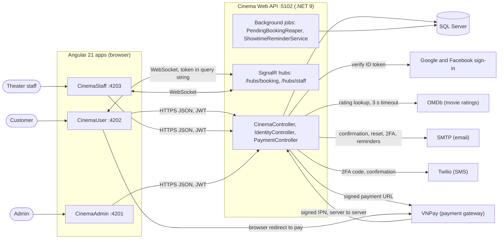
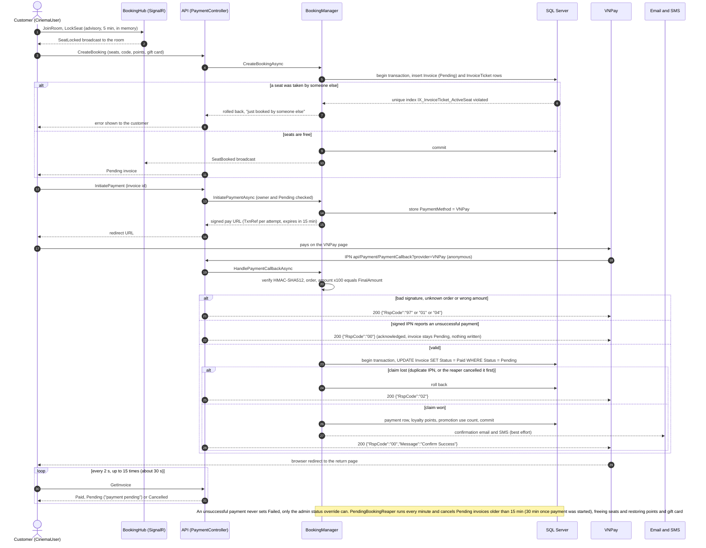
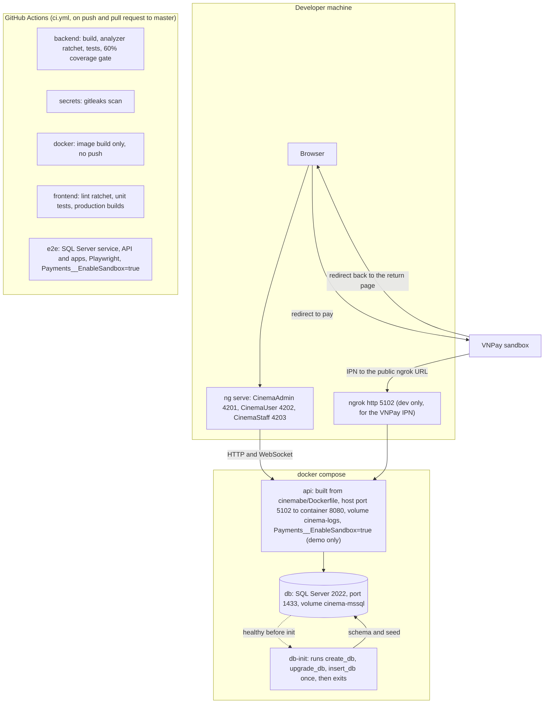

# Diagrams

> Purpose: Four views of the system as Mermaid diagrams: system context, data model (ERD), the booking-to-VNPay-IPN sequence, and deployment.
> Sources: `docker-compose.yml`, `.github/workflows/ci.yml`, `cinemabe/sql/create_db.sql`, `cinemabe/Cinema/1-Service/Cinema.Service.WebApiHost/{Program.cs,Controllers/PaymentController.cs,Hubs/BookingHub.cs,Services/PendingBookingReaper.cs}`, `cinemabe/Cinema/2-Business/Cinema.Business/{Managers/BookingManager.cs,Payments/VnPayGateway.cs}`, `cinemabe/Cinema/3-Data/Cinema.Data/Stores/InvoiceStore.cs`, `docs/03-technical/{architecture,integrations,database-schema}.md`
> Last reviewed: 2026-11-12

The layer dependency graph (a fifth view) is in [`architecture.md`](architecture.md) section 2. Each diagram below lists what it was checked against, so a reader can re-verify it.

## 1. System context

Who uses the system, and which outside services it talks to. Ports are the development defaults from `AGENTS.md`.

Checked against: the three apps and ports in `AGENTS.md`; the controllers and hubs in `architecture.md` sections 4 and 5; gateway, OAuth, OMDb, SMTP and SMS integrations in `integrations.md`; the 3 second OMDb timeout at `DependencyInjection.cs:25`; the two hosted services in `Program.cs` and `architecture.md` section 8. SMTP and Twilio are used only when configured; otherwise a log-only implementation is registered (`integrations.md` section 6).

## 2. Data model (ERD)

Core entities and the foreign keys declared in `cinemabe/sql/create_db.sql` (`create_db.sql` creates 43 tables). Not drawn: `ComboItem` (two foreign keys to `FoodAndDrink`: the combo and its component) and `StockMovement` (a foreign key to `FoodAndDrink`); `Holiday`, `News`, `GiftCard`, `Template`, `SplashBanner` and `__EFMigrationsHistory` have no foreign keys; `LoyaltySetting` (`TheaterId`), `ReminderLog` (`UserId`, `ShowTimeId`), `Incident` (theater, room, seat, showtime and user ids) and `AuditLog` (by design) hold plain id columns with no foreign key. Primary keys are `Guid`; `InvoiceTicket` has a composite key.

```mermaid
erDiagram
    Theater ||--o{ Room : has
    Theater ||--o{ RoomType : defines
    Theater ||--o{ SeatType : defines
    Theater ||--o{ PatronCategory : defines
    Theater ||--o{ TimeSlot : defines
    Theater ||--o{ FoodAndDrink : stocks
    Theater |o--o{ User : "staff of"
    RoomType ||--o{ Room : classifies
    Room ||--o{ Seat : contains
    SeatType ||--o{ PatronCategory : "priced as"
    RoomType ||--o{ RoomTypePatronCategoryPrice : prices
    PatronCategory ||--o{ RoomTypePatronCategoryPrice : "priced in"
    TimeSlot ||--o{ TicketPrice : scopes
    RoomType ||--o{ TicketPrice : scopes

    AgeRestriction ||--o{ Movie : rates
    Movie ||--o{ ShowTime : "is screened as"
    ShowTime ||--o{ ShowTimeRoom : "is held in"
    Room ||--o{ ShowTimeRoom : hosts
    Movie ||--o{ MovieCredit : credits
    Person ||--o{ MovieCredit : "appears in"
    Movie ||--o{ MovieTypeDetail : tagged
    MovieType ||--o{ MovieTypeDetail : tags
    Movie ||--o{ Comment : receives
    Movie ||--o{ Evaluation : receives

    UserType ||--o{ User : "role of"
    MemberShip ||--o{ User : "tier of"
    User |o--o{ Invoice : "places (customer optional)"
    Theater |o--o{ Invoice : "sold at"
    PromotionProgram |o--o{ Invoice : "applied to"
    User ||--o{ Comment : writes
    User ||--o{ Evaluation : writes
    Comment |o--o{ Comment : "reply to"

    Invoice ||--o{ InvoiceTicket : contains
    Seat ||--o{ InvoiceTicket : "sold as"
    ShowTimeRoom ||--o{ InvoiceTicket : "sold for"
    Invoice ||--o{ InvoicePayment : "paid by"
    Invoice ||--o{ InvoiceFoodAndDrink : includes
    FoodAndDrink ||--o{ InvoiceFoodAndDrink : "sold as"

    PromotionCampaign |o--o{ PromotionProgram : groups
    Movie |o--o{ PromotionProgram : "limited to"
    MemberShip |o--o{ PromotionProgram : "minimum tier"
    PromotionProgram ||--o{ PromotionProgramPrice : prices
    PromotionProgram ||--o{ PromotionProgramSchedule : schedules

    Invoice {
        Guid Id PK
        Guid UserId FK "nullable: walk-in counter sales have no customer"
        int Status "Pending, Paid, Cancelled, Failed"
        string PaymentMethod
        string PaymentReference
    }
    InvoiceTicket {
        Guid InvoiceId PK
        Guid ShowTimeId PK
        Guid RoomId PK
        Guid SeatId PK
        bool IsActive "unique per seat while 1"
        bool IsUsed
    }
```

Checked against: every relationship line is a `FOREIGN KEY` in `create_db.sql`, inline in a `CREATE TABLE` or added by `ALTER TABLE` (extracted by script on 2026-11-12); `FK_Invoice_User_UserId` is inline at `create_db.sql:515`, and the `Theater` and `PromotionProgram` ones are added by `ALTER TABLE` at `create_db.sql:836-843`. `Invoice.UserId` is altered to nullable at `create_db.sql:825-827`. Two guarantees worth knowing: the unique filtered index `IX_InvoiceTicket_ActiveSeat` on `(ShowTimeId, RoomId, SeatId) WHERE IsActive = 1` (`create_db.sql:717`) is what stops double booking across server instances, and `Invoice.GiftCardId` is a plain column with no foreign key (the column is declared at `create_db.sql:507` without a constraint). Field-level detail is in [`database-schema.md`](database-schema.md).

## 3. Booking, VNPay IPN and confirmation

The money path. The IPN (the signed server-to-server call) is the only thing that marks an invoice Paid; the browser redirect only shows the result.

Checked against: `PaymentController.cs:74` (CreateBooking), `:297`/`:313` (GetInvoice family), `:166` (IPN reply built by `VnPayGateway.BuildIpnResponse`); `BookingManager.cs:1086` (atomic Pending to Paid claim) and `:1831`, `:1856` (reaper claim); the codes 00/01/02/04/97/99 in `business-rules.md` section 3; `BookingHub.cs:22-49` (`SeatLocked`/`SeatUnlocked`; `SeatBooked` is sent from `BookingManager` through `ISeatNotificationService`); `payment-return.component.ts:18-19` (2 s, 15 attempts); `VnPayGateway.cs:74` (15 minute expiry); `PendingBookingReaper.cs:12-13`. The unsuccessful-payment branch is `BookingManager.cs:1059-1061` (`PaymentFailedAcknowledged`); `InvoiceStatus.Failed` is reached only through `InvoiceAdminManager.UpdateStatusAsync` (`InvoiceAdminManager.cs:42-62`). Unresolved gateway outcomes (for example a payment confirmed after the invoice was cancelled) answer `RspCode` 02 and produce no ticket (`business-rules.md` section 2).

## 4. Deployment

What runs where today. There is no release or deploy pipeline: CI builds and tests only (`docs/05-process/deployment.md`). The compose file is a local demo stack.

Checked against: `docker-compose.yml` (services `db`, `db-init`, `api`, ports `1433` and `5102:8080`, volumes `cinema-mssql`, `cinema-logs`, `db-init` starts after `db` is healthy and the `api` after `db-init` completes); `ci.yml` job names and triggers (lines 1-9 and the `backend`, `secrets`, `docker`, `frontend`, `e2e` jobs); `AGENTS.md` for the three dev ports and the ngrok requirement. The CI `e2e` job sets `Payments__EnableSandbox` at `ci.yml:198` and the compose file sets it too (see ADR-0007). The compose `api` service runs with `ASPNETCORE_ENVIRONMENT=Production` and `Payments__EnableSandbox=true`, which is for local demos only. Student input needed: where the system is meant to be hosted for the final demonstration, if anywhere beyond a laptop; no hosting target is recorded in the repository.
